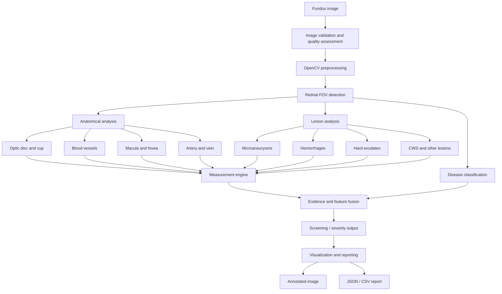

# FUNDUS AI --- Complete Pipeline & Implementation Plan

**Project goal:** Build a modular research prototype for comprehensive
retinal fundus image analysis using OpenCV and Deep Learning.

**Primary output:** Annotated fundus image, anatomical and lesion
measurements, disease-screening predictions, and structured JSON/CSV
reports.

> **Medical-use limitation:** This is a research and screening
> prototype, not a replacement for an ophthalmologist. A color fundus
> image alone cannot confirm every disease or provide every clinical
> measurement. Clinical use requires expert review, appropriate
> reference standards, external validation, and regulatory assessment.

------------------------------------------------------------------------

## 1. Project objectives

The system will:

1.  Load and validate a fundus image.
2.  Assess image quality and identify ungradable images.
3.  Preprocess the image with OpenCV.
4.  Detect the retinal field of view (FOV).
5.  Segment anatomical structures.
6.  Detect and segment retinal lesions.
7.  Classify supported disease labels and severity grades.
8.  Calculate image-based measurements.
9.  Combine model outputs while preserving uncertainty.
10. Generate annotated images and structured reports.

### Three different AI tasks

  ------------------------------------------------------------------------
  Task                     Purpose                 Output
  ------------------------ ----------------------- -----------------------
  Detection/localization   Find an object or       Bounding box, centroid
                           lesion                  

  Segmentation             Identify pixels         Binary or multiclass
                           belonging to a          mask
                           structure/lesion        

  Classification/grading   Predict image-level     Label, score, grade
                           disease labels or       
                           severity                
  ------------------------------------------------------------------------

Detection, segmentation, disease classification, severity grading, and
clinical diagnosis are not interchangeable.

------------------------------------------------------------------------

## 2. Recognition scope

### 2.1 Anatomical structures

  -----------------------------------------------------------------------------
  Structure               Task                          Potential measurements
  ----------------------- ----------------------------- -----------------------
  Retinal field of view   Segmentation                  Retinal area,
                                                        valid-pixel ratio

  Optic disc (OD)         Segmentation                  Area,
                                                        horizontal/vertical
                                                        diameter

  Optic cup (OC)          Segmentation                  Area,
                                                        horizontal/vertical
                                                        diameter

  Retinal vessels         Segmentation                  Density, length, width,
                                                        branching

  Arteries and veins      Subtype                       Arteriolar/venular
                          segmentation/classification   features, A/V ratio

  Macula                  Localization/region           Coordinates, region
                          estimation                    

  Fovea                   Landmark localization         Coordinates, distance
                                                        to disc

  Retinal regions         Spatial mapping               Lesion distribution by
                                                        region
  -----------------------------------------------------------------------------

**Limitations:** Not all datasets annotate all structures. Artery/vein
classification is a separate task from vessel segmentation. Fovea
localization requires suitable landmark labels or a validated
localization method. Cup-to-disc ratio (CDR) is not a standalone
glaucoma diagnosis.

### 2.2 Retinal lesions

  --------------------------------------------------------------------------
  Lesion                  Abbreviation            Proposed task
  ----------------------- ----------------------- --------------------------
  Microaneurysms          MA                      Small-lesion
                                                  detection/segmentation

  Hemorrhages             HE                      Detection/segmentation

  Hard exudates           EX                      Segmentation

  Soft exudates / cotton  SE/CWS                  Detection/segmentation
  wool spots                                      

  Neovascularization      NV                      Detection/classification
                                                  if suitable labels exist

  Drusen                  ---                     Detection/segmentation

  Optic disc swelling     ---                     Assessment with specialist
                                                  validation
  --------------------------------------------------------------------------

Unannotated pixels or images must not automatically be treated as
confirmed negative examples.

### 2.3 Disease-screening targets

Potential targets include:

-   Diabetic retinopathy (DR).
-   Glaucoma-related optic nerve abnormalities.
-   Hypertensive retinopathy signs.
-   Retinal vein occlusion signs.
-   Age-related macular degeneration (AMD) signs.
-   Pathological myopia signs.
-   Normal / no apparent abnormality.

Diseases may coexist. Use multi-label classification when supported by
the dataset. Do not combine labels from different datasets without
reconciling their definitions and reference standards.

------------------------------------------------------------------------

## 3. System architecture



Build independent modules so each can be trained, evaluated, and
debugged separately.

------------------------------------------------------------------------

## 4. Technology stack

  Area                   Recommended technology
  ---------------------- ------------------------------------
  Programming            Python
  Image processing       OpenCV
  Numerical processing   NumPy, SciPy
  Deep learning          PyTorch
  Segmentation           U-Net, Attention U-Net, U-Net++
  Encoders               ResNet34, EfficientNet
  Classification         EfficientNet-B0, ResNet, MobileNet
  Classical ML           scikit-learn, XGBoost
  Augmentation           Albumentations
  Visualization          OpenCV, Matplotlib
  Evaluation             scikit-learn, TorchMetrics
  Experiment tracking    TensorBoard or MLflow
  Annotation             CVAT or Label Studio
  Optional API/UI        FastAPI, Streamlit

Install PyTorch using the official selector for the chosen Python/CUDA
combination: https://pytorch.org/get-started/locally/

------------------------------------------------------------------------

## 5. Phase 1 --- Environment and project setup

### Windows PowerShell

``` powershell
mkdir FUNDUS_AI
cd FUNDUS_AI

py -3.14 -m venv .venv
.\.venv\Scripts\Activate.ps1

python -m pip install --upgrade pip

pip install opencv-python numpy scipy pillow
pip install pandas scikit-learn matplotlib
pip install albumentations segmentation-models-pytorch
pip install tensorboard mlflow
```

Install PyTorch separately from its official installation page. If a
package does not support the selected Python version, use a compatible
Python environment rather than forcing incompatible dependencies.

### Hardware

A Windows laptop with 16 GB RAM and integrated Intel graphics can handle
preprocessing, dataset inspection, annotation review, visualization, and
small CPU inference tests. Use a CUDA-enabled NVIDIA GPU or cloud GPU
for practical U-Net/EfficientNet training.

------------------------------------------------------------------------

## 6. Phase 2 --- Dataset collection and preparation

### 6.1 Recommended datasets

  -----------------------------------------------------------------------
  Dataset                 Main purpose            Annotation/use
  ----------------------- ----------------------- -----------------------
  DRIVE                   Vessel segmentation     Vessel masks; official
                                                  split

  STARE                   Retinal image analysis  Vessel annotations and
                                                  disease examples

  RITE                    Artery/vein analysis    Artery/vein labels

  REFUGE                  Optic disc/cup and      Disc/cup masks, fovea
                          glaucoma challenge      landmarks, glaucoma
                                                  labels

  IDRiD                   DR lesions and severity Lesion masks and
                                                  DR-related labels

  APTOS 2019              DR severity             Image-level severity
                          classification          grades

  ODIR-5K                 Multi-disease           Patient-level
                          classification          multi-label data
  -----------------------------------------------------------------------

Verify dataset access, licensing, permitted use, annotation
availability, and label definitions on official pages before
downloading.

Starting links:

-   DRIVE: https://drive.grand-challenge.org/
-   REFUGE: https://refuge.grand-challenge.org/
-   IDRiD: https://idrid.grand-challenge.org/
-   APTOS 2019: https://www.kaggle.com/c/aptos2019-blindness-detection
-   STARE: https://cecas.clemson.edu/\~ahoover/stare/
-   RITE: verify the current official distribution and terms.

### 6.2 Dataset mapping

  Module                         Initial dataset
  ------------------------------ --------------------
  Vessel segmentation            DRIVE
  Artery/vein segmentation       RITE
  Optic disc/cup                 REFUGE
  Fovea localization             REFUGE
  Lesion segmentation            IDRiD
  DR grading                     IDRiD and/or APTOS
  Multi-disease classification   ODIR-5K

Confirm exact annotation files and image coverage before writing data
loaders.

### 6.3 Directory structure

``` text
datasets/
├── raw/
│   ├── drive/
│   ├── rite/
│   ├── refuge/
│   ├── idrid/
│   ├── aptos/
│   └── odir/
├── processed/
├── annotations/
└── splits/
```

### 6.4 Data splitting and audit

For custom splits:

-   Split by patient, not by individual image.
-   Keep both eyes from one patient in the same split.
-   Prevent duplicate and near-duplicate leakage.
-   Keep the test set untouched during model selection.
-   Use external data for cross-dataset validation where possible.

A 70/15/15 train/validation/test split can be a starting point, not a
universal rule. Preserve official challenge splits when reporting
benchmark results.

Audit image count, patient count, image dimensions, camera/source, class
balance, mask coverage, annotation definitions, missing labels, and
duplicates.

------------------------------------------------------------------------

## 7. Phase 3 --- Image quality assessment

The system should flag or reject ungradable images before disease
analysis.

  Indicator        Possible method
  ---------------- -----------------------------------
  Blur             Variance of Laplacian
  Brightness       Mean intensity
  Contrast         Standard deviation / histogram
  Exposure         Histogram and saturation analysis
  FOV coverage     Retinal mask coverage
  File integrity   Image validation

Example:

``` python
import cv2
import numpy as np

def assess_image(image_path):
    image = cv2.imread(image_path)
    if image is None:
        raise ValueError("Cannot load fundus image")

    gray = cv2.cvtColor(image, cv2.COLOR_BGR2GRAY)

    blur_score = cv2.Laplacian(
        gray, cv2.CV_64F
    ).var()

    return {
        "blur_score": float(blur_score),
        "brightness": float(np.mean(gray)),
        "contrast": float(np.std(gray))
    }
```

Calibrate quality thresholds using representative images and expert
gradability labels. There is no universal blur threshold suitable for
every camera. Use explicit statuses such as `gradable`, `ungradable`,
and `review_required`.

------------------------------------------------------------------------

## 8. Phase 4 --- OpenCV preprocessing

### Steps

1.  Load and validate the image.
2.  Detect the retinal field of view.
3.  Mask or remove irrelevant black borders.
4.  Resize while preserving aspect ratio where appropriate.
5.  Generate RGB and auxiliary channels.
6.  Apply contrast enhancement where useful.
7.  Normalize model inputs.
8.  Save preprocessing metadata.

Example:

``` python
import cv2

def preprocess_fundus(image_path, size=512):
    image = cv2.imread(image_path)
    if image is None:
        raise ValueError("Invalid image")

    image = cv2.resize(image, (size, size))

    green = image[:, :, 1]

    clahe = cv2.createCLAHE(
        clipLimit=2.0,
        tileGridSize=(8, 8)
    )

    enhanced_green = clahe.apply(green)
    enhanced_green = cv2.GaussianBlur(
        enhanced_green, (3, 3), 0
    )

    return {
        "rgb_bgr": image,
        "green": green,
        "enhanced_green": enhanced_green
    }
```

Do not use only the green channel for every task:

  Task                          Useful input
  ----------------------------- --------------------------------
  Vessel segmentation           Green channel and/or RGB
  Hard exudates                 RGB, HSV, LAB
  Hemorrhages                   RGB and color/texture features
  Disease classification        RGB baseline
  General lesion segmentation   RGB with validated enhancement

Keep the original image. Enhanced images should be auxiliary inputs, not
replacements.

------------------------------------------------------------------------

## 9. Phase 5 --- Retinal field of view (FOV)

Detect the retinal region before calculating measurements.

Possible methods:

-   Thresholding against the black background.
-   Largest connected component.
-   Morphological closing/opening.
-   Contour filtering.
-   Learned FOV segmentation for difficult images.

Outputs:

-   FOV binary mask.
-   FOV bounding box.
-   Retinal pixel count.
-   Valid-pixel ratio.

Exclude black background pixels from vessel density, lesion ratios, and
other measurements.

------------------------------------------------------------------------

## 10. Phase 6 --- Anatomical segmentation and localization

### 10.1 Optic disc and optic cup

**Model:** U-Net or Attention U-Net with a ResNet/EfficientNet encoder.\
**Initial dataset:** REFUGE.

Outputs:

-   Disc mask and cup mask.
-   Contours and centroids.
-   Horizontal/vertical diameters.
-   Area measurements.
-   Vertical and horizontal CDR.

\[ VCDR = `\frac{D_{\text{cup, vertical}}}`{=tex}
{D\_{`\text{disc, vertical}`{=tex}}} \]

\[ HCDR = `\frac{D_{\text{cup, horizontal}}}`{=tex}
{D\_{`\text{disc, horizontal}`{=tex}}} \]

\[ AreaRatio = `\frac{A_{\text{cup}}}{A_{\text{disc}}}`{=tex} \]

CDR depends on segmentation quality and image geometry. It must not be
used alone to diagnose glaucoma. Disc size, clinical examination, OCT,
visual fields, and other evidence may be needed.

### 10.2 Blood vessel segmentation

**Model:** U-Net with ResNet34 encoder.\
**Initial dataset:** DRIVE.

Pipeline:

1.  Extract FOV.
2.  Generate green-channel and/or RGB input.
3.  Apply augmentation during training.
4.  Train vessel segmentation model.
5.  Predict a vessel probability map.
6.  Tune threshold on validation data.
7.  Generate binary mask.
8.  Apply cautious morphological cleanup.
9.  Calculate vessel measurements.

Potential measurements:

-   Vessel density.
-   Total vessel length.
-   Mean vessel width.
-   Vessel tortuosity.
-   Branch-point count.

Skeletonization can estimate centerline length, but graph-based branch
analysis and width estimation require careful validation.

### 10.3 Artery and vein classification

This is a separate task after vessel segmentation.

Possible methods:

-   Pixel-level artery/vein segmentation.
-   Vessel-tree classification.
-   Patch-based classification followed by propagation along vessel
    segments.

Initial dataset: RITE, subject to annotation/license verification.

Potential measurements include arteriolar/venular density and width.
Report an A/V ratio only when the vessel-selection and measurement
protocol are explicitly defined.

### 10.4 Macula and fovea localization

Use landmark localization or heatmap regression.

Possible models:

-   CNN heatmap regression.
-   U-Net landmark heatmap.
-   Coordinate regression.

Example output:

``` json
{
  "fovea": {"x": 256, "y": 280},
  "optic_disc": {"x": 390, "y": 250},
  "disc_fovea_distance_px": 136.8
}
```

\[ D = `\sqrt{(x_1-x_2)^2+(y_1-y_2)^2}`{=tex} \]

Coordinates and distances are in pixels unless validated calibration is
available.

------------------------------------------------------------------------

## 11. Phase 7 --- Lesion detection and segmentation

Use candidate generation, deep-learning segmentation, and classification
together. OpenCV thresholds can generate candidate regions but are not
definitive lesion recognition.

### 11.1 Microaneurysms

-   Very small red lesions.
-   Easily confused with noise and small vessels.
-   May disappear when the full image is aggressively resized.

Approach:

1.  Preserve adequate resolution.
2.  Generate green-channel/color candidate maps.
3.  Use local contrast and morphology as auxiliary processing.
4.  Train patch-based classification or high-resolution segmentation.
5.  Merge patch predictions into original image coordinates.
6.  Evaluate lesion-level sensitivity.

Outputs: count, centroid, individual area, confidence.

### 11.2 Hemorrhages

Potential approach:

-   RGB/LAB color features.
-   Candidate extraction.
-   U-Net or another segmentation architecture.
-   Connected-component analysis.

Outputs: count, total area, individual area, centroid, distance to
fovea, regional distribution.

### 11.3 Hard exudates

Potential approach:

-   RGB/HSV/LAB features.
-   Bright-region candidate extraction.
-   Morphological processing.
-   U-Net segmentation.

Outputs: component/cluster count, total area, individual area, distance
to fovea, spatial distribution.

### 11.4 Cotton wool spots / soft exudates

Use texture, local contrast, and deep-learning detection/segmentation.
Specialist-reviewed annotations are important because appearance can
overlap with other bright lesions.

### 11.5 Neovascularization

Requires specialist-defined annotations and careful distinction from
normal vessels and other vascular abnormalities. Do not label every
small or tortuous vessel as neovascularization.

### 11.6 Drusen and AMD-related features

Use color/texture features, lesion detection/segmentation, and
image-level classification. AMD assessment should consider lesion size,
number, distribution, and pigmentary changes. Color fundus photography
cannot show every retinal layer; OCT may be clinically required.

### 11.7 IDRiD considerations

IDRiD is a useful starting point for DR research. It contains
image-level disease grading and a smaller subset with pixel-level lesion
annotations. Confirm the exact image/mask coverage for each lesion from
the official documentation.

-   Do not treat unannotated images as confirmed negatives.
-   Use patient-level splits where identifiers are available.
-   Consider high-resolution patch training for small lesions.
-   Record the annotation definition for each class.

------------------------------------------------------------------------

## 12. Phase 8 --- Disease classification

### 12.1 Image-based classifier

Baseline models:

-   EfficientNet-B0.
-   ResNet50.
-   MobileNetV2.

Start with one clearly defined task and dataset, such as DR severity
classification.

### 12.2 Multi-label classification

For coexisting diseases, use multi-label classification rather than a
single softmax class.

``` python
import torch
import torch.nn as nn

criterion = nn.BCEWithLogitsLoss()

labels = torch.tensor(
    [[1, 0, 1, 0, 0]],
    dtype=torch.float32
)

logits = model(image)
loss = criterion(logits, labels)
```

Define label order, class imbalance handling, missing-label policy, and
thresholds from the dataset documentation.

### 12.3 Severity grading

For DR, labels may represent:

-   No apparent DR.
-   Mild NPDR.
-   Moderate NPDR.
-   Severe NPDR.
-   Proliferative DR.

Use a model/loss suitable for ordinal grading where appropriate.
Evaluate per-grade performance and clinically meaningful
sensitivity/specificity, not accuracy alone.

### 12.4 Feature fusion

A later version may combine:

-   CNN image features.
-   Segmentation-derived measurements.
-   Clinical metadata only when legitimately available and governed.

\[ F = Fusion(F\_{`\text{image}`{=tex}},
F\_{`\text{measurements}`{=tex}}) \]

Compare image-only, measurement-only, and fusion baselines on the same
patient-level test set. Do not assume fusion improves performance.

------------------------------------------------------------------------

## 13. Phase 9 --- Measurement engine

Operate on validated masks and landmarks.

### 13.1 Optic disc/cup measurements

  Measurement                         Unit
  ----------------------------------- -------
  Disc area                           px²
  Cup area                            px²
  Disc horizontal/vertical diameter   px
  Cup horizontal/vertical diameter    px
  Vertical CDR                        Ratio
  Horizontal CDR                      Ratio
  Cup/disc area ratio                 Ratio

### 13.2 Vessel measurements

  Measurement                Unit
  -------------------------- ---------------------------------
  Vessel density             \%
  Total vessel length        px
  Mean vessel width          px
  Vessel tortuosity          Dimensionless, protocol-defined
  Branch-point count         Count
  Artery/vein measurements   Protocol-defined

Example definition:

\[ VesselDensity = `\frac{\text{Vessel pixels within valid FOV}}`{=tex}
{`\text{Valid FOV pixels}`{=tex}}`\times100`{=tex} \]

### 13.3 Lesion measurements

  Measurement              Unit
  ------------------------ ----------
  Lesion count             Count
  Individual lesion area   px²
  Total lesion area        px²
  Lesion area ratio        \%
  Lesion centroid          x, y
  Distance to fovea        px
  Region/quadrant          Category

\[ LesionAreaRatio = `\frac{\text{Lesion pixels}}`{=tex}
{`\text{Valid FOV pixels}`{=tex}}`\times100`{=tex} \]

### 13.4 Spatial measurements

-   Disc-to-fovea distance.
-   Lesion-to-fovea distance.
-   Lesion-to-disc distance.
-   Lesion distribution by quadrant.
-   Lesion distribution within a defined macular grid.

ETDRS-style regions require a properly defined coordinate system and
scale. Do not claim physical ETDRS dimensions from an uncalibrated
image.

### 13.5 Pixel-to-physical calibration

A standard fundus image does not automatically provide a reliable
conversion from pixels to millimeters or micrometers. Report pixel units
by default. Convert to physical units only with validated
camera-specific calibration and imaging geometry.

------------------------------------------------------------------------

## 14. Phase 10 --- Severity and screening logic

Keep separate:

1.  Detection.
2.  Segmentation.
3.  Classification.
4.  Severity grading.
5.  Clinical diagnosis.

Possible screening evidence:

-   MA, hemorrhages, and exudates may contribute to DR screening.
-   Optic disc/cup features may contribute to glaucoma screening.
-   Arteriolar narrowing, AV nicking, and hemorrhages may contribute to
    hypertensive retinopathy assessment.
-   Venous dilation, tortuosity, and hemorrhages may contribute to
    retinal vein occlusion assessment.

These are candidate signs, not deterministic rules. A clinician must
interpret them in context. Do not convert one measurement directly into
a disease diagnosis using an unvalidated hand-written rule.

------------------------------------------------------------------------

## 15. Phase 11 --- Model training

### 15.1 Baseline models

  Task                     Model                     Possible loss
  ------------------------ ------------------------- ------------------------------
  Optic disc/cup           U-Net + ResNet34          Dice + BCE
  Vessel segmentation      U-Net + ResNet34          Dice + BCE
  Lesion segmentation      U-Net / Attention U-Net   Dice + BCE or Focal
  Fovea localization       CNN heatmap regression    MSE
  Disease classification   EfficientNet-B0           BCEWithLogits
  DR severity              EfficientNet-B0           Cross-entropy / ordinal loss

### 15.2 Initial configuration

``` python
CONFIG = {
    "image_size": 512,
    "batch_size": 4,
    "epochs": 50,
    "learning_rate": 0.0001,
    "optimizer": "AdamW",
    "weight_decay": 0.0001,
    "early_stopping_patience": 10,
    "seed": 42
}
```

This is a starting configuration, not a guaranteed optimum. Tune per
task and hardware.

### 15.3 Training practices

-   Save best checkpoint based on validation metrics.
-   Use learning-rate scheduling and early stopping.
-   Log training/validation loss.
-   Save seeds, configurations, and package versions.
-   Track model and dataset versions.
-   Use mixed precision where supported.
-   Monitor class imbalance.
-   Prevent patient leakage.
-   Keep an independent test set.

### 15.4 Augmentation

Possible augmentations:

-   Horizontal flip, with laterality/labels transformed consistently.
-   Small rotations.
-   Mild brightness/contrast changes.
-   Mild color jitter.
-   Scale and crop.
-   Carefully selected blur/noise.

Apply identical geometric transforms to image and mask. Avoid
unrealistic anatomy or transformations that change disease labels.

------------------------------------------------------------------------

## 16. Phase 12 --- Evaluation

### 16.1 Segmentation metrics

  -----------------------------------------------------------------------
  Metric                              Purpose
  ----------------------------------- -----------------------------------
  Dice                                Overlap between prediction and
                                      reference

  IoU                                 Intersection over union

  Precision                           Fraction of predicted positive
                                      pixels that are correct

  Recall/sensitivity                  Fraction of reference positive
                                      pixels detected

  Specificity                         Fraction of reference negative
                                      pixels correctly identified
  -----------------------------------------------------------------------

\[ Dice = `\frac{2|A\cap B|}{|A|+|B|}`{=tex} \]

For small lesions, report lesion-level sensitivity and false positives
per image as well as pixel-level metrics.

### 16.2 Classification metrics

-   Accuracy.
-   Per-class precision.
-   Per-class recall/sensitivity.
-   Specificity.
-   F1-score.
-   ROC-AUC.
-   PR-AUC.
-   Confusion matrix.
-   Calibration metrics where appropriate.

Report macro averages and per-class results. For screening, report
sensitivity and specificity at predefined operating thresholds.

### 16.3 Localization metrics

-   Euclidean localization error.
-   Mean localization error.
-   Success rate within a predefined tolerance.

### 16.4 Measurement validation

Compare model measurements against expert references using:

-   Mean absolute error.
-   Bland--Altman analysis.
-   Intraclass correlation coefficient (ICC), when appropriate.
-   Inter-grader and intra-grader variability.

### 16.5 External validation

Test on images from different sources/cameras where possible. Fundus
images vary by camera, field of view, resolution, illumination, and
population.

------------------------------------------------------------------------

## 17. Phase 13 --- Visualization

### 17.1 Suggested anatomical colors

  Structure             Display color
  --------------------- ---------------
  Optic disc boundary   Blue
  Optic cup boundary    Green
  Blood vessels         Red
  Fovea landmark        Yellow
  Macular region        Cyan

### 17.2 Suggested lesion colors

  Lesion               Display color
  -------------------- ---------------
  Microaneurysms       Red
  Hemorrhages          Orange
  Hard exudates        Yellow
  Cotton wool spots    White
  Neovascularization   Purple
  Drusen               Light green

These are display conventions, not clinical standards.

### 17.3 OpenCV overlay function

``` python
import cv2
import numpy as np

def overlay_mask(image, mask, color, alpha=0.4):
    output = image.copy()
    colored_mask = np.zeros_like(image)
    colored_mask[mask > 0] = color

    return cv2.addWeighted(
        image, 1 - alpha,
        colored_mask, alpha, 0
    )
```

Example:

``` python
image = cv2.imread("fundus.jpg")

image = overlay_mask(
    image, vessel_mask, (0, 0, 255)
)
image = overlay_mask(
    image, exudate_mask, (0, 255, 255)
)
image = overlay_mask(
    image, hemorrhage_mask, (0, 165, 255)
)

cv2.imwrite("fundus_annotated.jpg", image)
```

The masks must already exist and match the image dimensions. This
function visualizes masks; it does not detect lesions.

### 17.4 Layer controls

Allow the user to toggle:

-   Original image.
-   FOV mask.
-   Optic disc/cup.
-   Blood vessels.
-   Arteries/veins.
-   Microaneurysms.
-   Hemorrhages.
-   Hard exudates.
-   Other supported lesions.
-   Combined overlay.

Display confidence, quality warnings, and uncertainty flags.

------------------------------------------------------------------------

## 18. Phase 14 --- Report generation

Generate:

1.  Annotated PNG.
2.  Individual masks.
3.  JSON report.
4.  CSV measurements.
5.  Optional PDF summary.

### Example JSON schema

``` json
{
  "image_id": "fundus_001",
  "quality": {
    "status": "gradable",
    "blur_score": 125.6
  },
  "anatomical_structures": {
    "optic_disc": {
      "area_px2": 12500,
      "diameter_px": 130
    },
    "optic_cup": {
      "area_px2": 4200,
      "vertical_cdr": 0.62
    },
    "fovea": {
      "x": 256,
      "y": 280
    },
    "blood_vessels": {
      "density_percent": 18.5,
      "total_length_px": 12500
    }
  },
  "lesions": [
    {
      "type": "hard_exudate",
      "count": 4,
      "total_area_px2": 820,
      "confidence": 0.94
    },
    {
      "type": "hemorrhage",
      "count": 3,
      "total_area_px2": 1200,
      "confidence": 0.89
    }
  ],
  "disease_predictions": {
    "diabetic_retinopathy": 0.91,
    "glaucoma": 0.23,
    "amd": 0.12
  },
  "status": "requires_clinical_review",
  "model_versions": {
    "vessel": "v1",
    "optic_disc_cup": "v1",
    "lesion": "v1",
    "classifier": "v1"
  }
}
```

All numbers above are fabricated examples. Real reports must use actual
model outputs and validated measurement code. Store model/preprocessing
versions, thresholds, camera metadata, laterality, calibration
information where available, and quality flags. Avoid unnecessary
patient-identifying information.

------------------------------------------------------------------------

## 19. Recommended source-code structure

``` text
FUNDUS_AI/
├── datasets/
│   ├── raw/
│   ├── processed/
│   ├── annotations/
│   └── splits/
├── configs/
│   ├── preprocessing.yaml
│   ├── segmentation.yaml
│   ├── classification.yaml
│   └── evaluation.yaml
├── src/
│   ├── preprocessing/
│   │   ├── loader.py
│   │   ├── quality_assessment.py
│   │   ├── fov_detection.py
│   │   ├── enhancement.py
│   │   └── normalization.py
│   ├── anatomical/
│   │   ├── optic_disc.py
│   │   ├── optic_cup.py
│   │   ├── vessel_segmentation.py
│   │   ├── artery_vein.py
│   │   └── fovea_detection.py
│   ├── lesions/
│   │   ├── microaneurysm.py
│   │   ├── hemorrhage.py
│   │   ├── hard_exudate.py
│   │   ├── cotton_wool.py
│   │   ├── neovascularization.py
│   │   └── drusen.py
│   ├── models/
│   │   ├── unet.py
│   │   ├── attention_unet.py
│   │   ├── efficientnet.py
│   │   └── fusion_model.py
│   ├── measurements/
│   │   ├── optic_disc_metrics.py
│   │   ├── vessel_metrics.py
│   │   ├── lesion_metrics.py
│   │   └── spatial_metrics.py
│   ├── classification/
│   │   ├── diabetic_retinopathy.py
│   │   ├── glaucoma.py
│   │   ├── hypertension.py
│   │   ├── amd.py
│   │   └── disease_fusion.py
│   ├── visualization/
│   │   ├── mask_overlay.py
│   │   ├── bounding_boxes.py
│   │   ├── gradcam.py
│   │   └── report_visualizer.py
│   └── evaluation/
│       ├── segmentation_metrics.py
│       ├── classification_metrics.py
│       └── measurement_validation.py
├── checkpoints/
│   ├── optic_disc/
│   ├── vessels/
│   ├── lesions/
│   └── classification/
├── outputs/
│   ├── annotated_images/
│   ├── masks/
│   ├── reports/
│   └── logs/
├── tests/
├── main.py
├── requirements.txt
└── README.md
```

Create modules progressively; do not create every empty file at the
beginning.

------------------------------------------------------------------------

## 20. Twelve-week implementation roadmap

  -----------------------------------------------------------------------
  Week                    Main work               Deliverable
  ----------------------- ----------------------- -----------------------
  1                       Environment, datasets,  Dataset-ready project
                          annotation audit        

  2                       Quality assessment,     Preprocessing pipeline
                          FOV, preprocessing      

  3                       Optic disc/cup          OD/OC model
                          segmentation            

  4                       Vessel segmentation     Vessel model

  5                       Fovea localization and  Landmark module
                          spatial measurements    

  6                       Microaneurysm and       Red-lesion module
                          hemorrhage experiments  

  7                       Exudates, CWS, other    Lesion module
                          supported lesions       

  8                       Disease classification  Classifier baseline
                          and DR grading          

  9                       Measurement engine      Measurement outputs

  10                      Integration and feature Integrated pipeline
                          fusion                  

  11                      Visualization and       Annotated image +
                          report generation       JSON/CSV

  12                      Independent testing,    Research prototype
                          error analysis,         
                          documentation           
  -----------------------------------------------------------------------

The schedule assumes datasets and annotations are accessible. Expert
annotation work can extend the timeline.

------------------------------------------------------------------------

## 21. Final evaluation and safety checklist

-   [ ] Image-quality module flags ungradable images.
-   [ ] FOV masking excludes black borders from measurements.
-   [ ] Dataset splits are patient-independent.
-   [ ] Duplicate images do not leak into test data.
-   [ ] Each model has documented training data and label definitions.
-   [ ] Segmentation models are evaluated against reference masks.
-   [ ] Lesion detection is evaluated at pixel and lesion level.
-   [ ] Classification is evaluated per class.
-   [ ] Confidence scores are calibrated or explicitly described as
    uncalibrated.
-   [ ] Measurements are compared with expert references.
-   [ ] Pixel-to-physical conversion is not used without calibration.
-   [ ] Uncertain outputs are flagged.
-   [ ] Model and preprocessing versions are recorded.
-   [ ] External validation is performed where possible.
-   [ ] Outputs are clearly labeled as research/screening results, not
    definitive diagnosis.

------------------------------------------------------------------------

## 22. Milestone 1 --- First implementation sprint

### Objective

Build a working foundation that loads a fundus image, assesses basic
quality, preprocesses it, and saves intermediate outputs.

### Checklist

-   [ ] Create `FUNDUS_AI` project.
-   [ ] Create and activate a Python virtual environment.
-   [ ] Install OpenCV, NumPy, SciPy, and PyTorch.
-   [ ] Download DRIVE.
-   [ ] Download REFUGE.
-   [ ] Download IDRiD.
-   [ ] Audit dataset folders and annotations.
-   [ ] Implement `image_loader.py`.
-   [ ] Implement `quality_assessment.py`.
-   [ ] Implement `enhancement.py`.
-   [ ] Save and inspect preprocessing outputs.
-   [ ] Record package versions and configurations.

### Acceptance criteria

A sample image should produce:

``` text
outputs/
└── sample_001/
    ├── original.png
    ├── green_channel.png
    ├── enhanced_green.png
    ├── fov_mask.png
    └── quality_report.json
```

Move to optic disc/cup segmentation only after this pipeline works
consistently on representative images.

------------------------------------------------------------------------

## 23. Final recommended development order

1.  OpenCV preprocessing and quality control.
2.  Retinal FOV segmentation.
3.  Optic disc/cup segmentation.
4.  Blood vessel segmentation.
5.  Fovea localization.
6.  Lesion detection and segmentation.
7.  Disease classification.
8.  Measurement engine.
9.  Model integration and feature fusion.
10. Annotated visualization and reporting.
11. Independent and external validation.

**Final project definition:** FUNDUS AI is a modular research prototype
for retinal fundus image analysis that combines OpenCV-based image
processing with deep-learning models for anatomical segmentation, lesion
detection, disease screening, quantitative measurements, and annotated
reporting.

The final deliverable is an analysis package containing the original
image, anatomical and lesion overlays, quantitative measurements,
screening predictions, quality flags, and model provenance.
