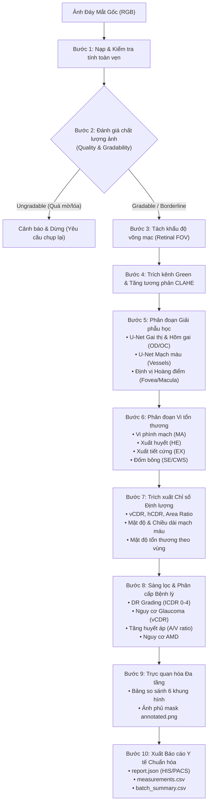

# FUNDUS AI — Retinal Fundus Image Analysis Prototype

> **Medical Disclaimer:** This system is a modular research and screening prototype, NOT a replacement for an ophthalmologist. Color fundus photography alone cannot confirm every disease or substitute comprehensive clinical examination (e.g. OCT, visual field, intraocular pressure).

---

## 1. Project Overview

**FUNDUS AI** is a modular deep learning and computer vision pipeline for comprehensive retinal fundus image processing, anatomical structure segmentation, lesion detection, quantitative biomarker measurement, disease screening, and structured clinical report generation.

### Pipeline Workflow:
```text
Fundus Image ──► Quality Assessment (Blur, Brightness, Contrast, FOV)
             ──► Contrast Enhancement (Green-channel CLAHE, LAB, HSV)
             ──► Anatomical Segmentation:
                 • Optic Disc & Optic Cup (U-Net, VCDR, HCDR, Area Ratio)
                 • Blood Vessel Network (U-Net, Density, Length, Branching)
                 • Artery / Vein Classification (3-Class U-Net, A/V Ratio)
                 • Fovea & Macula Localization (Disc-Fovea Distance)
             ──► Retinal Lesion Segmentation:
                 • Microaneurysms (MA), Haemorrhages (HE)
                 • Hard Exudates (EX), Soft Exudates / Cotton Wool Spots (SE/CWS)
             ──► Disease Screening & Grading:
                 • Diabetic Retinopathy (5-grade ICDR scale via EfficientNet-B0)
                 • Glaucoma Risk Indicators (vCDR analysis + clinical validation)
                 • Multi-Disease Screening (8 disease categories via DenseNet-121)
                 • Hypertensive Retinopathy Signs & AMD Indicators
             ──► Multi-Layer Visualization & Diagnostic Reporting (JSON, CSV, Annotated PNG)
```

---

## 2. Directory Structure

```text
eyes/
├── datasets/                     # Thư mục chứa các bộ dữ liệu đáy mắt
│   └── raw/                      # Dữ liệu ảnh và nhãn gốc (6 Gold-Standard Datasets)
│       ├── REFUGE2/              # [M1] Optic Disc & Cup + Glaucoma (1.200 ảnh: Train 400, Val 400, Test 400)
│       ├── drive/                # [M2] Retinal Blood Vessel Segmentation (40 ảnh: 20 train, 20 test)
│       ├── rite/                 # [M3] Artery/Vein 3-Class Segmentation (40 ảnh)
│       ├── idrid/                # [M4] Multi-Lesion Segmentation: MA, HE, EX, SE (81 ảnh)
│       ├── aptos/                # [M5] DR Severity 5-Grade Classification (3.662 ảnh train)
│       └── odir/                 # [M6] Multi-Disease 8-Class Classification (3.500 bệnh nhân ODIR-5K)
├── manifests/                    # Danh sách CSV chuẩn hóa quản lý đường dẫn tương đối (Relative POSIX)
│   ├── optic_disc_cup/           # refuge2_train.csv, refuge2_val.csv, refuge2_test.csv, refuge2_all.csv
│   ├── vessel/                   # drive_train.csv, drive_test.csv
│   ├── artery_vein/              # rite_train.csv, rite_test.csv
│   ├── dr_lesions/               # idrid_lesions_train.csv, idrid_lesions_test.csv
│   ├── dr_grading/               # aptos_train.csv, aptos_test.csv
│   └── multi_disease/            # odir_train.csv, odir_val.csv (phân tách theo patient_id)
├── configs/                      # File cấu hình tham số tiền xử lý và mô hình (YAML)
├── src/                          # Mã nguồn module hóa
│   ├── datasets/                 # PyTorch DataLoaders (REFUGE2, DRIVE, RITE, IDRiD, APTOS, ODIR)
│   ├── models/                   # U-Net, Attention U-Net, EfficientNet, DenseNet-121, MultiChannelLosses
│   ├── training/                 # Scripts huấn luyện từng module chuyên biệt
│   ├── evaluation/               # Scripts đánh giá hiệu năng (Segmentation & Classification Benchmarks)
│   ├── preprocessing/            # Quality assessment, FOV aperture, Green-CLAHE normalization
│   ├── anatomical/               # Deep Learning Segmenters (Optic Disc, Cup, Vessels, Fovea)
│   ├── lesions/                  # Phát hiện vi tổn thương võng mạc (MA, HE, EX, SE)
│   ├── measurements/             # Đo đạc gai thị (vCDR), mạch máu, diện tích tổn thương
│   ├── classification/           # Chấm điểm DR, nguy cơ Glaucoma, AMD, Cao huyết áp
│   └── visualization/            # Bảng báo cáo 6 khung hình, overlay chẩn đoán đa tầng
├── checkpoints/                  # Trọng số mô hình đã huấn luyện (.pth)
│   ├── optic_disc_cup/           # best_od_oc_model.pth (M1: REFUGE2, Val Mean Dice: 0.7806)
│   ├── vessels/                  # best_vessel_model.pth (M2: DRIVE, Val Dice: 0.7253)
│   ├── artery_vein/              # best_av_model.pth (M3: RITE, Val Mean Dice: 0.5689)
│   ├── lesions/                  # best_lesion_model.pth (M4: IDRiD, Multi-channel 4 classes)
│   └── classification/           # best_dr_classifier.pth (M5: QWK 0.9176), best_odir_classifier.pth (M6: F1 0.5897)
├── outputs/                      # Báo cáo, bảng tổng hợp và hình ảnh xuất ra
├── tests/                        # 22 unit tests tự động kiểm thử toàn bộ hệ thống
├── main.py                       # CLI Runner chính chạy toàn bộ Pipeline End-to-End
├── conftest.py                   # Cấu hình đường dẫn gốc cho Pytest
└── requirements.txt              # Danh sách thư viện Python
```

---

## 3. Cài đặt môi trường (Setup Guide)

Khuyến nghị sử dụng **Python 3.11** (hoặc 3.12):

```powershell
# 1. Tạo môi trường ảo
python -m venv .venv

# 2. Kích hoạt môi trường ảo
# Trên Windows PowerShell:
.\.venv\Scripts\Activate.ps1
# Hoặc trên Linux / macOS:
source .venv/bin/activate

# 3. Nâng cấp pip và cài đặt dependencies
python -m pip install --upgrade pip
pip install -r requirements.txt

# 4. (Tùy chọn) Cài đặt PyTorch hỗ trợ GPU NVIDIA (CUDA 12.1):
pip install torch torchvision --index-url https://download.pytorch.org/whl/cu121
```

---

## 4. Chi tiết Kiến trúc & Các Bước Xử lý của Pipeline End-to-End

Pipeline End-to-End thực hiện xử lý ảnh đáy mắt qua **10 bước tuần tự khép kín**, kết hợp giữa Deep Learning hiện đại và các thuật toán thị giác máy tính giải phẫu học:



### Bước 1 — Image Ingestion & Input Validation
* Đọc ảnh từ đường dẫn định dạng JPG, PNG, TIF, BMP.
* Kiểm tra tính toàn vẹn của tệp, bảo đảm ảnh có đúng 3 kênh màu (RGB), kích thước tối thiểu đạt tiêu chuẩn phân tích lâm sàng.

### Bước 2 — Image Quality & Gradability Assessment (Đánh giá chất lượng ảnh)
* **Độ mờ (Blur):** Tính toán phương sai của toán tử vi phân bậc hai Laplacian ($\sigma^2_{Laplacian}$). Nếu điểm số $< 30.0$, ảnh bị đánh giá là mờ do mất nét hoặc đục thể thủy tinh.
* **Độ sáng & Tương phản:** Phân tích biểu đồ histogram kênh màu xám và độ tương phản RMS để phát hiện tình trạng lóa sáng quá mức (overexposure) hoặc thiếu sáng nghiêm trọng (underexposure).
* **Quyết định chất lượng:**
  * `gradable`: Đủ tiêu chuẩn chẩn đoán y khoa.
  * `borderline`: Chất lượng trung bình, vẫn phân tích nhưng kèm cờ cảnh báo độ tin cậy.
  * `ungradable_repeat_image`: Ảnh không đạt chất lượng tối thiểu, hệ thống từ chối đưa ra kết luận giả và khuyến nghị chụp lại đáy mắt.

### Bước 3 — Retinal Field of View (FOV) Detection (Nhận diện khẩu độ võng mạc)
* Tự động tạo mặt nạ nhị phân tách biệt vùng lòng mắt tròn và viền đen nền ngoài camera đáy mắt.
* Áp dụng Otsu thresholding kết hợp phép đóng hình thái học (`morphologyEx CLOSE`) và tìm đường bao lồi lớn nhất (`findContours`) để loại trừ nhiễu viền ngoài nhãn cầu.

### Bước 4 — Contrast Enhancement & Green Channel Normalization
* **Trích xuất kênh Green:** Đây là kênh có độ tương phản tự nhiên cao nhất do hemoglobin trong máu hấp thụ ánh sáng xanh lá mạnh nhất, giúp mạch máu và vi tổn thương nổi rõ nét so với nền võng mạc.
* **Áp dụng CLAHE:** (Contrast Limited Adaptive Histogram Equalization) với `clipLimit=2.0`, `tileGridSize=(8, 8)` giúp làm sắc nét các vi mạch li ti và ranh giới tổn thương mà không khuếch đại nhiễu nền.
* **Chuẩn hóa hình học:** Resize và đệm đối xứng (letterbox padding) sang kích thước $512 \times 512$ chuẩn để giữ nguyên tỷ lệ khung hình thật của nhãn cầu.

### Bước 5 — Anatomical Structure Segmentation (Phân đoạn cấu trúc giải phẫu)
* **Phân đoạn Đĩa thị (Optic Disc) & Hõm gai thị (Optic Cup):**
  * Nạp mô hình **U-Net 2 kênh** (`checkpoints/optic_disc_cup/best_od_oc_model.pth` huấn luyện trên REFUGE2).
  * Kênh 0 dự đoán mặt nạ Đĩa thị; Kênh 1 dự đoán Hõm gai thị.
  * **Hậu xử lý giải phẫu:** Áp dụng `cv2.connectedComponentsWithStats` chọn duy nhất 1 thành phần liên thông lớn nhất kết hợp mặt nạ viền co `eroded_fov` để xóa sổ hoàn toàn các vệt quang sai lóa sáng hình lưỡi liềm ở rìa ống kính (như ảnh `V0002`).
  * **Ràng buộc giải phẫu học:** Ép Hõm gai thị luôn nằm trọn vẹn bên trong Đĩa thị (`oc_mask = cv2.bitwise_and(oc_mask, od_mask)`).
* **Phân đoạn Mạng lưới Mạch máu (Retinal Blood Vessels):**
  * Nạp mô hình **U-Net binary** (`checkpoints/vessels/best_vessel_model.pth` huấn luyện trên DRIVE).
  * Trích xuất toàn bộ cây mao mạch và tĩnh/động mạch chính thành mask nhị phân 0/255.
  * Tự động lọc sạch các hạt nhiễu li ti rời rạc bằng bộ lọc hình thái học `remove_small_objects(min_size=30)`.
* **Phân loại Động mạch / Tĩnh mạch (Artery / Vein):**
  * Mô hình 3 lớp phân biệt nền võng mạc (0), động mạch (1 - đỏ), tĩnh mạch (2 - xanh dương) trên RITE, lọc nhiễu hạt `remove_small_objects(min_size=30)` phục vụ đo tỷ lệ AVR chuẩn lâm sàng tại Zone B.
* **Định vị Hoàng điểm & Hõm trung tâm (Fovea & Macula Localization):**
  * Dựa trên vị trí giải phẫu: Hoàng điểm luôn nằm về phía thái dương (temporal) cách tâm đĩa thị một khoảng cố định bằng 2.0 - 2.5 lần đường kính đĩa thị.
  * Thuật toán tự động tìm tâm vùng vô mạch hoàng điểm (FAZ) - điểm trũng tối nhất trong kênh Green trong vùng tìm kiếm kỳ vọng.

### Bước 6 — Retinal Lesion Segmentation (Phát hiện vi tổn thương võng mạc)
* **Vi phình mạch (Microaneurysms - MA):** Dò tìm các chấm đỏ cực nhỏ (ngưỡng xác suất $p \ge 0.65$).
* **Xuất huyết võng mạc (Haemorrhages - HE):** Phát hiện đốm máu sẫm màu với ngưỡng nâng cao $p \ge 0.70$ để triệt tiêu hiện tượng bùng nổ mảng đỏ (False Positive).
* **Xuất tiết cứng (Hard Exudates - EX):** Phát hiện mảng lipid màu vàng sáng có bờ sắc nét ($p \ge 0.50$).
* **Đốm bông / Xuất tiết mềm (Cotton Wool Spots - CWS/SE):** Phát hiện vùng nhồi máu lớp sợi thần kinh màu trắng đục ($p \ge 0.50$).
* **Mặt nạ loại trừ giải phẫu (Anatomical Exclusion Mask):** Tự động loại bỏ mọi tổn thương giả nằm đè lên mạng lưới mạch máu, đĩa thị hoặc rìa ngoài nhãn cầu:
  $$\text{ValidRetina} = \text{ErodedFOV} \cap \neg (\text{VesselMask} \cup \text{OpticDiscMask})$$

### Bước 7 — Quantitative Biomarkers Extraction (Trích xuất chỉ số sinh học định lượng)
* **Chỉ số Gai thị (Optic Nerve Biomarkers):**
  * Đường kính dọc đĩa thị ($H_{disc}$) và lõm gai ($H_{cup}$).
  * Tỷ lệ lõm gai trên gai thị dọc: $vCDR = \frac{H_{cup}}{H_{disc}}$.
  * Tỷ lệ ngang $hCDR = \frac{W_{cup}}{W_{disc}}$ và Tỷ lệ diện tích $AreaRatio = \frac{Area_{cup}}{Area_{disc}}$.
* **Chỉ số Mạch máu (Vascular Biomarkers):**
  * Mật độ mạch máu toàn võng mạc (Vessel Density %).
  * Tổng chiều dài mạng lưới mao mạch (Total Vessel Length px).
* **Thống kê Mật độ Tổn thương (Lesion Burden):**
  * Số lượng và tổng diện tích từng loại tổn thương (MA, HE, EX, CWS).
  * Phân bố không gian theo 3 vùng đồng tâm tính từ tâm Fovea: Vùng hoàng điểm (<1 đường kính đĩa thị), Vùng quanh hoàng điểm (1-2 đường kính), Vùng chu biên (>2 đường kính).

### Bước 8 — Multi-Disease Screening & Staging Logic (Sàng lọc & Phân cấp bệnh lý)
* **Bệnh võng mạc đái tháo đường (Diabetic Retinopathy - DR):**
  * Xếp loại theo thang quốc tế ICDR (0: No DR, 1: Mild, 2: Moderate, 3: Severe, 4: Proliferative DR) kết hợp mật độ tổn thương và mạng nơ-ron phân loại.
* **Đánh giá nguy cơ Glaucoma (Thiên đầu thống):**
  * Phân tầng nguy cơ dựa trên chỉ số $vCDR$:
    * $vCDR < 0.5$: Nguy cơ thấp (Bình thường).
    * $0.5 \le vCDR < 0.65$: Nghi ngờ (Suspicious).
    * $vCDR \ge 0.65$: Nguy cơ cao (Glaucomatous).
* **Bệnh võng mạc tăng huyết áp (Hypertensive Retinopathy):**
  * Cảnh báo co hẹp tiểu động mạch khi tỷ lệ $A/V < 0.67$.
* **Thoái hóa hoàng điểm tuổi già (AMD):**
  * Phát hiện Drusen và xuất tiết trong vùng hoàng điểm.
* **Phân loại đa bệnh lý ODIR-5K:**
  * Dự đoán vector xác suất 8 bệnh lý: Normal (N), Diabetes (D), Glaucoma (G), Cataract (C), AMD (A), Hypertension (H), Myopia (M), Others (O).

### Bước 9 — Multi-Layer Visualization & Diagnostic Overlays (Trực quan hóa đa tầng)
* Bảng 6 khung hình so sánh toàn diện (`report_panel.png`):
  1. *Original Fundus:* Ảnh đáy mắt gốc chuẩn hóa.
  2. *CLAHE Green Channel:* Kênh xanh lá nổi bật mạch máu.
  3. *Retinal FOV Mask:* Mặt nạ nhị phân trường quan sát.
  4. *Optic Disc & Cup:* Phân đoạn Gai thị (xanh lá) và Lõm gai (tím).
  5. *Blood Vessels:* Phân đoạn mạng lưới mạch máu toàn diện.
  6. *Multi-Layer Diagnostic Overlay:* Lớp phủ chẩn đoán tích hợp (tâm hoàng điểm màu vàng, viền bao đĩa thị màu xanh dương, vector nối gai thị - hoàng điểm, các vi tổn thương màu sắc riêng).
* Ảnh annotated overlay tổng hợp (`annotated.png`).
* Từng mask nhị phân tách riêng trong thư mục `masks/*.png`.

### Bước 10 — Structured Clinical Report Generation (Xuất báo cáo y khoa)
* `report.json`: Hồ sơ điện tử y tế chuẩn hóa JSON đầy đủ số đo định lượng và kết luận sàng lọc, sẵn sàng tích hợp vào hệ thống HIS/PACS.
* `measurements.csv`: File bảng tính chứa toàn bộ các giá trị đo đạc.
* `batch_summary.csv`: Bảng tổng hợp tự động khi xử lý hàng loạt nhiều ca bệnh.

---

## 5. Hướng dẫn Lập trình Trực tiếp bằng Python (Programmatic API)

Ngoài việc chạy dòng lệnh CLI, bạn có thể dễ dàng nhúng toàn bộ Pipeline vào ứng dụng Web (FastAPI/Streamlit/Flask) hoặc hệ thống y tế hiện có bằng Python API:

```python
from main import run_pipeline

# Chạy phân tích ảnh đáy mắt và nhận kết quả dạng Dictionary
results = run_pipeline(
    image_path="datasets/raw/REFUGE2/Train/REFUGE1-val/REFUGE-Validation400/V0001.jpg",
    output_dir="outputs/patient_001",
    target_size=512
)

# Truy xuất các chỉ số quan trọng
quality = results["quality"]["status"]                    # 'gradable', 'ungradable'
vcdr = results["measurements"]["optic_cup"]["vertical_cdr"] # Ví dụ: 0.742
dr_grade = results["screening"]["diabetic_retinopathy"]["grade"] # 0, 1, 2, 3, 4
glaucoma_risk = results["screening"]["glaucoma"]["risk_level"]  # 'low', 'high'

print(f"Chất lượng ảnh: {quality}")
print(f"Chỉ số vCDR: {vcdr} -> Đánh giá Glaucoma: {glaucoma_risk}")
print(f"Chẩn đoán DR: Cấp {dr_grade}")
```

---

## 6. Hướng dẫn Chi tiết Step-by-Step chạy End-to-End khi CÓ TOÀN BỘ Datasets

Quy trình thực hiện một vòng đời End-to-End chuẩn từ chuẩn hóa dữ liệu, huấn luyện các module, thẩm định nội bộ / ngoại vi, đến phân tích suy luận hàng loạt diễn ra theo **4 giai đoạn tuần tự**:

---

### Giai đoạn 0: Sinh danh mục Manifests chuẩn hóa (Phase 0)

Trước khi train hoặc suy luận, chạy script đồng bộ để tự động dò quét toàn bộ ảnh và nhãn trong `datasets/raw/`, tạo các file CSV quản lý đường dẫn tương đối (Relative POSIX) và phân tách bệnh nhân chống rò rỉ:

```powershell
python src/datasets/build_manifests.py
```

* **Kết quả tạo ra trong `manifests/`:**
  * `optic_disc_cup/`: `refuge2_train.csv` (400 ảnh), `refuge2_val.csv` (400 ảnh), `refuge2_test.csv` (400 ảnh), `refuge2_all.csv` (1.200 ảnh).
  * `vessel/`: `drive_train.csv` (20 ảnh), `drive_test.csv` (20 ảnh).
  * `artery_vein/`: `rite_train.csv` (20 ảnh), `rite_test.csv` (20 ảnh).
  * `dr_lesions/`: `idrid_lesions_train.csv` (54 ảnh), `idrid_lesions_test.csv` (27 ảnh).
  * `dr_grading/`: `aptos_train.csv` (3.662 ảnh), `aptos_test.csv` (1.928 ảnh).
  * `multi_disease/`: `odir_train.csv` (2.975 bệnh nhân), `odir_val.csv` (525 bệnh nhân).

---

### Giai đoạn 1: Huấn luyện & Đánh giá từng Module chuyên biệt (Training & Evaluation)

Mỗi mô hình chịu trách nhiệm một tác vụ chuyên biệt theo thiết kế chuẩn của **FUNDUS_AI_Dataset_Training_Plan_2.md**:

#### 1.1 Phân đoạn Mạch máu võng mạc (Module M2 — U-Net trên DRIVE)
* **Nguyên tắc:** Huấn luyện và đánh giá trên bộ dữ liệu **DRIVE** chuẩn.
```powershell
# Huấn luyện U-Net trên DRIVE training set:
python src/training/train_vessels.py --epochs 30 --batch_size 4 --image_size 512

# Đánh giá hiệu năng trên DRIVE test set (Dice, IoU, Sensitivity, Specificity):
python src/evaluation/evaluate_vessels.py --checkpoint checkpoints/vessels/best_vessel_model.pth --manifest manifests/vessel/drive_test.csv
```
* **Checkpoint:** `checkpoints/vessels/best_vessel_model.pth`.
* **Kết quả chi tiết:** `outputs/vessel_evaluation_results.csv`.

#### 1.2 Phân đoạn Đĩa thị & Hõm gai thị (Module M1 — U-Net trên REFUGE2)
* **Nguyên tắc:** **REFUGE2** (1.200 ảnh: Train 400, Val 400, Test 400) là tập benchmark chuẩn MICCAI độc lập cho phân đoạn Đĩa thị (OD), Hõm gai thị (Cup), đo tỷ lệ vCDR và sàng lọc Glaucoma.
```powershell
# 1. Huấn luyện U-Net 2 kênh (Channel 0: Optic Disc, Channel 1: Optic Cup) trên REFUGE2:
python src/training/train_optic_disc_cup.py --epochs 25 --batch_size 4 --image_size 512

# 2. Đánh giá kiểm thử độc lập trên REFUGE2 test set (400 ảnh):
python src/training/train_optic_disc_cup.py --eval_only --test_manifest manifests/optic_disc_cup/refuge2_test.csv --image_size 512

# 3. Đánh giá toàn diện Segmentation, vCDR MAE và Glaucoma Screening (ROC-AUC):
python src/evaluation/evaluate_optic_disc_cup.py --manifest manifests/optic_disc_cup/refuge2_test.csv --image_size 512
```
* **Checkpoint:** `checkpoints/optic_disc_cup/best_od_oc_model.pth`.
* **Biểu đồ & Analytics:** `outputs/plots/optic_disc_cup/history.csv`, `outputs/plots/optic_disc_cup/`.
* **Kết quả chi tiết:** `outputs/optic_disc_cup_refuge2_evaluation.csv`.

#### 1.3 Phân biệt Động mạch / Tĩnh mạch (Module M3 — U-Net 3-Class trên RITE)
* **Tác vụ:** Phân loại pixel 3 lớp: Nền võng mạc (0), Động mạch (1), Tĩnh mạch (2).
```powershell
python src/training/train_artery_vein.py --epochs 20 --batch_size 2 --image_size 512
```
* **Checkpoint:** `checkpoints/artery_vein/best_av_model.pth`.

#### 1.4 Phân đoạn Vi tổn thương đáy mắt (Module M4 — Multi-channel U-Net trên IDRiD)
* **Tác vụ:** Phân đoạn 4 loại tổn thương đái tháo đường: MA (Microaneurysms), HE (Haemorrhages), EX (Hard Exudates), SE (Soft Exudates) với hàm mất mát `MultiChannelFocalDiceLoss` và Early Stopping.
```powershell
python src/training/train_lesions.py --epochs 25 --batch_size 2 --image_size 512 --patience 6
```
* **Checkpoint:** `checkpoints/lesions/best_lesion_model.pth`.

#### 1.5 Phân loại Mức độ Bệnh võng mạc Đái tháo đường (Module M5 — EfficientNet-B0 trên APTOS)
* **Tác vụ:** Phân loại 5 cấp độ DR (0: No DR, 1: Mild, 2: Moderate, 3: Severe, 4: Proliferative DR) với `CategoricalFocalLoss(gamma=2.0, label_smoothing=0.1)` và Early Stopping (Best QWK: 0.9176).
```powershell
python src/training/train_dr_grading.py --epochs 20 --batch_size 12 --image_size 512 --patience 6
```
* **Checkpoint:** `checkpoints/classification/best_dr_classifier.pth`.

#### 1.6 Phân loại Đa bệnh lý Đáy mắt (Module M6 — DenseNet-121 trên ODIR-5K)
* **Tác vụ:** Dự đoán xác suất 8 nhóm bệnh lý độc lập (N, D, G, C, A, H, M, O) lưu checkpoint tối ưu theo Macro F1 Score (Best Macro F1: 0.5897).
```powershell
python src/training/train_multi_disease.py --epochs 30 --batch_size 8 --image_size 512
```
* **Checkpoint:** `checkpoints/classification/best_odir_classifier.pth`.

---

### Giai đoạn 2: Kiểm thử Toàn vẹn Hệ thống (Automated Unit Tests)

Chạy bộ kiểm thử tự động toàn diện kiểm tra GroupNorm U-Net, CategoricalFocalLoss, DataLoaders, các phép đo hình thái học và luồng pipeline:
```powershell
pytest tests/ -v
```
*(Yêu cầu: Toàn bộ **22/22 tests** đều hiển thị màu xanh lá `PASSED`)*.

---

### Giai đoạn 3: Chạy Pipeline Suy luận End-to-End (`main.py`)

Khi các file checkpoint đã có trong thư mục `checkpoints/`, `main.py` sẽ **tự động nạp các mô hình Deep Learning** (U-Net Đĩa thị/Hõm gai thị, U-Net Mạch máu, Bộ phát hiện tổn thương và Phân loại bệnh) thay thế cho các thuật toán hình thái thô sơ.

#### 3.1 Chạy chế độ Demo (Ảnh mô phỏng kiểm tra luồng nhanh):
```powershell
python main.py --demo --output_dir outputs/sample_demo
```

#### 3.2 Chạy phân tích trên 1 ảnh bệnh nhân cụ thể:
```powershell
# Chạy ảnh bất kỳ từ REFUGE2:
python main.py --image "datasets/raw/REFUGE2/Train/REFUGE1-val/REFUGE-Validation400/V0001.jpg" --output_dir "outputs/patient_refuge_001"

# Chạy ảnh từ DRIVE:
python main.py --image "datasets/raw/drive/test/images/01_test.tif" --output_dir "outputs/patient_drive_001"
```

#### 3.3 Chạy hàng loạt (Batch Processing) theo từng Dataset:
Hệ thống hỗ trợ phím tắt `--dataset` để tự động lấy ảnh từ các thư mục dữ liệu tương ứng:
```powershell
# Chạy 5 ảnh đầu tiên của REFUGE2:
python main.py --dataset refuge --limit 5 --output_dir "outputs/batch_refuge"

# Chạy 5 ảnh đầu tiên của DRIVE:
python main.py --dataset drive --limit 5 --output_dir "outputs/batch_drive"

# Chạy 5 ảnh đầu tiên của APTOS 2019:
python main.py --dataset aptos --limit 5 --output_dir "outputs/batch_aptos"

# Chạy 5 ảnh đầu tiên của IDRiD:
python main.py --dataset idrid --limit 5 --output_dir "outputs/batch_idrid"

# Chạy 5 ảnh đầu tiên của ODIR-5K:
python main.py --dataset odir --limit 5 --output_dir "outputs/batch_odir"
```

#### 3.4 Chạy Benchmark Hàng loạt trên TẤT CẢ 6 bộ dữ liệu cùng lúc:
Lệnh này sẽ tự động duyệt qua tất cả 6 dataset (`refuge`, `drive`, `rite`, `aptos`, `idrid`, `odir`), xử lý số ảnh được chọn và tổng hợp thành 1 bảng so sánh duy nhất:
```powershell
python main.py --dataset all --limit 2 --output_dir "outputs/benchmark_all_datasets"
```

---

### Giai đoạn 4: Đọc & Phân tích Kết quả Báo cáo

Sau khi chạy xong, mở thư mục đầu ra (ví dụ `outputs/benchmark_all_datasets/` hoặc thư mục bệnh nhân):

1. **Bảng tổng hợp chỉ số bệnh nhân toàn viện (`batch_summary.csv`):**
   * Tổng hợp các trường: `image_name`, `quality_status`, `blur_score`, `vertical_cdr`, `vessel_density_percent`, `vessel_length_px`, `dr_grade`, `dr_label`, `glaucoma_risk`, `screening_status`.
2. **Thư mục kết quả từng ca bệnh (`outputs/.../`):**
   * [`report_panel.png`](file:///c:/Users/THANH%20CONG/Documents/eyes/outputs/sample_demo/report_panel.png): Bảng hiển thị 6 khung hình chẩn đoán trực quan (Ảnh gốc, Kênh xanh CLAHE, Retinal FOV, Phân đoạn Gai thị & Hõm gai, Mạng lưới mạch máu, Lớp phủ chẩn đoán định vị Hoàng điểm và Gai thị).
   * [`annotated.png`](file:///c:/Users/THANH%20CONG/Documents/eyes/outputs/sample_demo/annotated.png): Ảnh phủ mask màu các lớp tổn thương và giải phẫu.
   * `masks/`: File mask nhị phân PNG riêng biệt cho từng cấu trúc (`optic_disc.png`, `optic_cup.png`, `vessels.png`, `hard_exudates.png`, `hemorrhages.png`, `microaneurysms.png`, `cotton_wool.png`).
   * `report.json`: Hồ sơ điện tử y khoa chuẩn hóa JSON chứa toàn bộ số đo định lượng và kết luận sàng lọc, sẵn sàng tích hợp vào hệ thống bệnh viện (HIS/PACS).
   * `measurements.csv`: File bảng tính chứa toàn bộ các phép đo hình thái (đường kính gai thị px, diện tích hõm gai, vCDR, hCDR, mật độ mạch máu %, độ ngoằn ngoèo).

---

## 7. Lưu ý quan trọng khi sao chép mã nguồn sang máy khác

> [!CAUTION]
> **TUYỆT ĐỐI KHÔNG nén thư mục `.venv/`**
> Thư mục `.venv` chứa binary và đường dẫn tuyệt đối gắn chặt với hệ điều hành và người dùng của máy hiện tại. Khi sang máy khác (Windows khác hoặc Ubuntu/Colab/Kaggle), chỉ cần nén code và chạy:
> ```bash
> python -m venv .venv
> pip install -r requirements.txt
> ```

Toàn bộ đường dẫn trong manifests và mã nguồn đã được chuẩn hóa **100% Relative POSIX Path** (`datasets/raw/...`) và khớp chính xác từng ký tự hoa/thường trên đĩa, đảm bảo chạy ổn định trên mọi môi trường.
